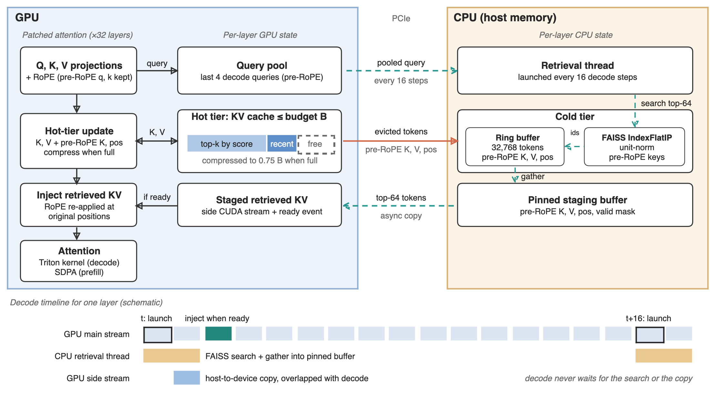

# hotcold-kv-cache

A two-tier KV cache for long-context LLM inference, benchmarked head-to-head against
SnapKV, PyramidKV and H2O on LongBench with Llama-3.1-8B.

- A **hot, compressed cache on the GPU**, held under a fixed token budget by a
  SnapKV-style eviction policy.
- A **cold, full-resolution store on the CPU**, indexed with FAISS, so any evicted
  token can be recalled by similarity search.
- An **asynchronous look-ahead retrieval** thread that uses recent query states to
  fetch the tokens upcoming steps are likely to need, overlapping the CPU→GPU copy
  with the decode step instead of stalling on it.



## Headline result

The project's clearest finding is an ablation, not a win over the baselines:
**how long a retrieved token stays in attention matters far more than the retrieval
itself.**

Three variants, identical except for what happens to tokens fetched from the CPU
tier. LongBench `gov_report`, 200 samples, 8k context, budget 512:

| Variant | PPL | Latency |
|---|---|---|
| No retrieval (`LOOKAHEAD_K=0`) | 6.139 | 1.601 s |
| Attend once — the obvious design | 6.126 | 2.023 s |
| **Held until replaced** (`HOLD_RETRIEVED=1`) | **6.039** | 2.249 s |

Retrieval originally fired every 16 decode steps and the fetched tokens were
attended at exactly one step, then dropped. That bought 0.09–0.21% perplexity for
roughly 25% more latency — almost nothing. Keeping the same tokens in attention
until the next retrieval replaces them helps in **all twelve** dataset/budget
configurations, by up to 3.18%, and is worth about seven times as much.

The no-retrieval control also locates the latency cost: with retrieval off, hot/cold
runs at 1.601 s, *faster* than the uncompressed reference at 1.718 s. The overhead is
the retrieval path, not the Triton kernel or the eviction logic.

Full numbers: [`results/retrieval_ablation.md`](results/retrieval_ablation.md).

## Benchmark results

Llama-3.1-8B (fp16) on one NVIDIA L40S 48 GB, LongBench prompts cut at 8192 tokens.
Perplexity is scored over the last 256 prompt tokens against the compressed cache,
with an identical protocol for every method. Latency is 63 decode steps after
prefill. Peak memory is `torch.cuda.max_memory_allocated()` over prefill plus a
64-token generation — **total** device memory, including the 14.96 GiB of weights,
not the KV cache alone.

`gov_report`, 200 samples, budget 512:

| Method | PPL | Δ vs full | Latency (s) | Peak mem (GiB) |
|---|---|---|---|---|
| full (uncompressed) | 5.247 | 0.0% | 1.718 | 18.99 |
| **snapkv** | **5.942** | +13.2% | 1.562 | 17.15 |
| pyramidkv | 6.352 | +21.1% | 1.560 | 17.16 |
| h2o | 6.430 | +22.5% | 1.751 | 17.33 |
| hotcold (held) | 6.039 | +15.1% | 2.249 | 17.19 |

Per-dataset tables, each with every budget and variant:

| Dataset | Samples | Context |
|---|---|---|
| [multifieldqa_en](results/multifieldqa_en_results.md) | 150 | 8k |
| [hotpotqa](results/hotpotqa_results.md) | 200 | 8k |
| [gov_report](results/gov_report_results.md) | 200 | 8k |
| [repobench-p](results/repobench-p_results.md) | 500 | 8k |
| [gov_report at 16k](results/gov_report_16k_results.md) | 200 | 16k |

**Where this stands honestly.** SnapKV is the strongest method at every budget on
every dataset tested. Held hot/cold is second in 11 of 12 configurations, ahead of
PyramidKV and well ahead of H2O, but it costs about 30% more decode latency than the
uncompressed run and saves no more GPU memory than the other compressed methods. At
8k the KV cache is only about 1 GiB of an 19 GiB footprint, which is why the memory
column barely separates the methods; at 16k the saving against `full` roughly doubles,
from about 1.8 GiB to 3.8 GiB.

The CPU tier gives a small, consistent, measurable gain (0.6–1.6% over the
no-retrieval control) at a 33–40% latency cost. Perplexity over continuous documents
rewards keeping broadly relevant recent context, which the GPU tier already does well.
A needle-in-a-haystack style task, where one specific distant fact has been evicted,
is the test that would show whether the retrieval tier earns its keep.

## How it works

The patched attention splits every step into four tensors — `q_pre`, `q_post`,
`k_pre`, `k_post` — and keeps keys in the cold tier **pre-RoPE**, re-rotating them to
their original positions when they are injected. That is what lets an evicted token
come back without a corrupted positional encoding.

Per decode step, per layer:

1. Project Q, K, V; apply RoPE; push the pre-RoPE query into a 4-entry pool.
2. Every 16 steps, hand the pooled query to a background thread, which searches the
   FAISS index and gathers 64 tokens into a pinned buffer.
3. A side CUDA stream copies them to the GPU; a ready event says when they have
   landed. Decode never blocks on either the search or the copy.
4. Inject the retrieved tokens (RoPE re-applied), attend over hot cache + injected
   tokens with a Triton kernel, then compress the hot tier if it exceeds the budget,
   evicting the losers to the CPU ring buffer and the FAISS index.

| Module | Responsibility |
|---|---|
| `src/hotcold_kv/patch.py` | Monkeypatches `LlamaAttention.forward`; RoPE re-rotation; injection and masking. |
| `src/hotcold_kv/controller.py` | `KVController` — cold ring buffer, FAISS index, query pooling, retrieval thread, prefetch staging. |
| `src/hotcold_kv/cache.py` | `HotColdLayer` — the hot compressed KV and the eviction policy. |
| `src/hotcold_kv/kernels.py` | Triton fused decode-attention kernel over the masked cache. |
| `src/hotcold_kv/baselines/` | Standalone SnapKV / PyramidKV / H2O implementations, each with its own cache and attention patch. |
| `benchmarks/run_baselines.py` | The harness that produced every table above. |
| `docs/figures/make_fig1.py` | Draws the architecture figure with `python-pptx`. |

See [`docs/OVERVIEW.md`](docs/OVERVIEW.md) for a file-by-file walkthrough and
[`docs/design.md`](docs/design.md) for the phased design and reference papers.

## Install

```bash
git clone <repo-url>
cd hotcold-kv-cache
pip install -r requirements.txt
pip install -e .
```

A CUDA GPU is required: the decode path is a Triton kernel and the prefetch uses a
side CUDA stream. Developed against `transformers==4.57.3`. The benchmarks need HF
access to `meta-llama/Llama-3.1-8B`.

## Reproducing the benchmarks

Point `LONGBENCH_PATH` at a directory of LongBench JSONL files, then:

```bash
MODEL_NAME=meta-llama/Llama-3.1-8B DATASET=gov_report KV_BUDGET=512 \
MAX_INPUT_LENGTH=8192 HOLD_RETRIEVED=1 python benchmarks/run_baselines.py
```

Key environment variables:

| Variable | Default | Meaning |
|---|---|---|
| `DATASET` | `multifieldqa_en` | LongBench task name |
| `KV_BUDGET` | 1024 | GPU token budget per layer |
| `MAX_INPUT_LENGTH` | 8192 | Prompt truncation |
| `METHODS` | all five | Comma-separated subset to run |
| `LOOKAHEAD_K` | 64 | Tokens fetched per retrieval; `0` disables retrieval |
| `HOLD_RETRIEVED` | 0 | `1` keeps a retrieved set until the next one replaces it |
| `CPU_BUFFER_SIZE` | 32768 | Cold ring-buffer capacity per layer |

`LOOKAHEAD_K=0` and `HOLD_RETRIEVED=1` change the method label and the output
filename (`hotcold_k0`, `hotcold_hold`), so variants never overwrite each other.
`scripts/combine_results.py` merges all result CSVs into one comparison table.

## Tests

CPU-only, no GPU or model download needed:

```bash
PYTHONPATH=src python tests/test_baselines.py    # baseline tensor logic
python tests/test_cold_store.py                  # cold tier / FAISS ring alignment
```

`tests/test_parity.py` needs a GPU: it checks that with compression and retrieval
disabled the patched model matches the unpatched one, token for token. Run it before
trusting any sweep — if parity fails, the benchmarks measure a bug rather than a
method.

## License

MIT — see [LICENSE](LICENSE).
