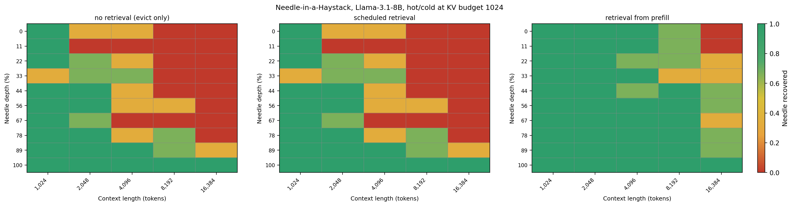

# Needle-in-a-Haystack

Does the CPU tier actually recover information that eviction throws away?

The LongBench perplexity tables answer a different question. They average over 256
scored tokens, so a method can look good by being broadly reasonable without ever
recovering a specific fact. This test isolates the fact.

A random 7-digit access code is hidden at a known depth in a long filler document
and asked for at the end. Scoring is an exact substring match, so the answer cannot
be guessed from world knowledge and no judge model is involved.



## Setup

| | |
|---|---|
| Model | Llama-3.1-8B, fp16, one NVIDIA L40S (48 GB) |
| KV budget | 1024 (recent window 128) |
| CPU ring | 32,768 tokens per layer, FAISS `IndexFlatIP` over pre-RoPE keys |
| Context lengths | 1,024 / 2,048 / 4,096 / 8,192 / 16,384 |
| Needle depths | 0, 11, 22, 33, 44, 56, 67, 78, 89, 100 % |
| Repeats per cell | 3, each with a different code and a different filler window |
| Decode | greedy, 16 new tokens |
| Haystack | LongBench `gov_report` + `multi_news` contexts, concatenated offline |

Every variant sees identical prompts: the needle value and the filler window are
seeded per cell, not per run, so the three panels are directly comparable.

At budget 1024 and 16k context roughly 178,500 tokens are evicted to the CPU tier
per cell, so the test does bite — the needle genuinely leaves the GPU.

## Variants

| Name | Behaviour |
|---|---|
| `k0` | `LOOKAHEAD_K=0`. Evict to the CPU tier, never fetch anything back. The control. |
| `hold` | Retrieve on the normal schedule (every 16 decode steps) and keep the retrieved tokens resident until the next retrieval replaces them. |
| `prefill` | `hold`, plus one synchronous retrieval per layer at the end of prefill. |

## Result

Fraction of cells recovered, averaged over all depths and repeats:

| Context | `k0` no retrieval | `hold` scheduled | `prefill` from prefill |
|---|---|---|---|
| 1,024 | 0.933 | 0.933 | **1.000** |
| 2,048 | 0.733 | 0.733 | **1.000** |
| 4,096 | 0.433 | 0.433 | **0.933** |
| 8,192 | 0.267 | 0.267 | **0.833** |
| 16,384 | 0.133 | 0.133 | **0.467** |

Paired per cell against the no-retrieval control, over all 150 cells:

| Variant | Needles won back | Needles lost |
|---|---|---|
| `hold` | 0 | 0 |
| `prefill` | **52** | **0** |

The CPU tier recovers 52 of the 150 needles that eviction alone loses, and costs
nothing anywhere: there is no cell where retrieval turns a pass into a fail.

## Scheduled retrieval does nothing here, and that is not a bug

`hold` is identical to `k0` in every one of the 150 cells. It is not disabled —
the counters show it injecting retrieved tokens — but the injection arrives too
late to matter.

The scheduled path first fires at decode step `window_size - 1` = 15. The needle
answer is about seven tokens. By the time the first retrieval lands, the answer
has already been emitted, so the retrieved tokens only ever influence trailing
filler.

This is precisely why the `prefill` variant exists. One synchronous retrieval at
the end of prefill puts the needle back in attention *before* the first output
token, and that single change is the entire 52-needle gain.

Note the contrast with the perplexity tables, where the ranking is the exact
reverse: there `hold` is what wins and a prefill retrieval is irrelevant. The two
tests measure different things. Perplexity averages over 256 scored tokens, where
sustained residency dominates; the needle answer is seven tokens, where only
what is resident at step zero matters. Neither variant is better in general —
the retrieval schedule has to match the shape of the output.

## Where it still fails

Under `prefill`, recovery is perfect through 2k and near-perfect at 4k. The
remaining failures are concentrated at 16k, at the shallow end of the document:

| Depth | 4,096 | 8,192 | 16,384 |
|---|---|---|---|
| 0 % | 1.00 | 0.67 | **0.00** |
| 11 % | 1.00 | 0.67 | **0.00** |
| 22 % | 0.67 | 0.67 | 0.33 |
| 33 % | 1.00 | 0.33 | 0.33 |
| 44–89 % | 0.67–1.00 | 1.00 | 0.67 |
| 100 % | 1.00 | 1.00 | 1.00 |

A needle at depth 0 of a 16k context is the hardest case in the grid: it is the
first thing evicted, it sits furthest from the query, and `LOOKAHEAD_K=64` tokens
per retrieval is a narrow window to find it in a 178k-token cold store. Depth
100 % is free, because the needle is still inside the recent window and never
leaves the GPU at all.

The obvious levers, untested: a larger `LOOKAHEAD_K`, more than one retrieval
during prefill, or a query pooled differently than the last 4 positions.

## Reproducing

```bash
NEEDLE_VARIANTS=k0,hold,prefill \
KV_BUDGET=1024 \
LENGTHS=1024,2048,4096,8192,16384 \
python benchmarks/run_needle.py

python scripts/plot_needle.py results/needle/needle_b1024_L16384.csv
```

Raw per-cell data, including the generated text for every cell:
[`needle/needle_b1024_L16384.csv`](needle/needle_b1024_L16384.csv).
